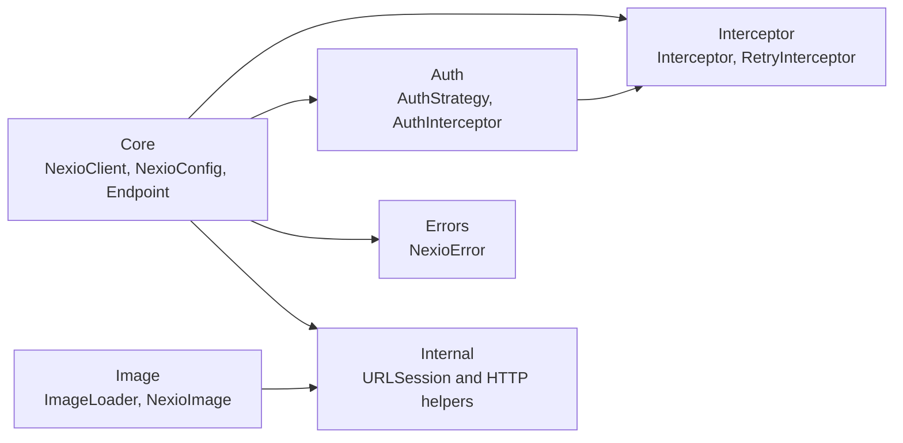
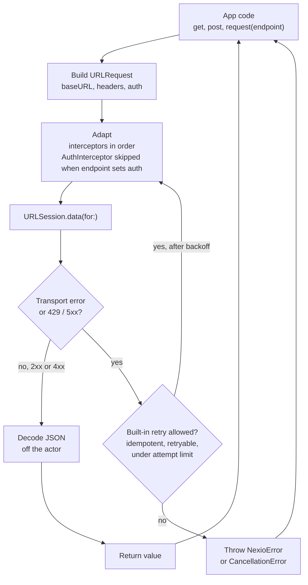
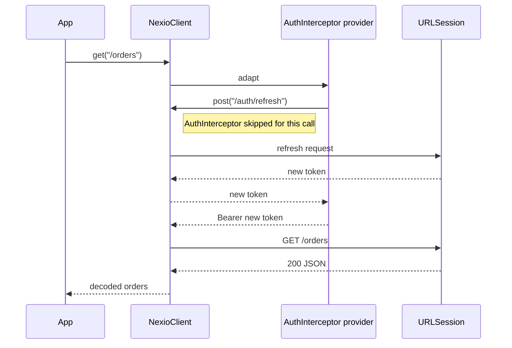

<div align="center">


**Lightweight, actor-based Swift networking SDK**

[](https://swift.org)
[](https://developer.apple.com)
[](https://swift.org/package-manager)
[](LICENSE)
[](https://github.com/ANSCoder/Nexio/actions/workflows/ci.yml)
[](https://codecov.io/gh/ANSCoder/Nexio)
[](https://swiftpackageindex.com/ANSCoder/Nexio)
[](https://swiftpackageindex.com/ANSCoder/Nexio)

Typed JSON requests · Auth strategies · Retry with backoff · Interceptor pipeline · SwiftUI image loading · Zero dependencies

</div>

---

## Features

- **Actor-based** — `NexioClient` is a Swift actor; its internal state is isolated, and it's safe to call from any concurrency context
- **Typed requests** — `get`, `post`, `put`, `patch` return decoded `Decodable` values; `delete` returns once the server responds successfully
- **Type-safe endpoints** — `Endpoint` protocol for grouping request details in reusable structs
- **Auth strategies** — bearer token, API key, custom headers, or dynamic provider (OAuth refresh)
- **Interceptor pipeline** — adapt requests and retry failures with full control
- **Retry with backoff** — none, linear, or exponential backoff; configurable per policy
- **SwiftUI image loading** — `NexioImage` drop-in for `AsyncImage` with `URLCache`-backed caching and prefetch
- **Structured errors** — `NexioError` covers network, auth, 4xx/5xx, and decoding failures
- **Zero dependencies** — pure Swift, built on `URLSession`

---

## Architecture

Nexio is split into a few layers. `NexioClient` is the only actor that owns request state, and it never blocks on I/O or decoding.

### Module map



### Request pipeline

Every request goes through the same loop. Retries re-enter it from the top, so each attempt gets fresh adaptation, including a fresh token.



### Token refresh without recursion

`AuthInterceptor` calls your provider before each request. If the provider itself calls Nexio to refresh the token, that refresh request skips the dynamic auth interceptor, so it can't loop back into the same provider.



### Rules the design guarantees

| Rule | Why |
|------|-----|
| Actor holds only state and bookkeeping | I/O and JSON decoding run outside it, so one large response never queues other requests. |
| Built-in retry policies retry only idempotent methods (GET, HEAD, PUT, DELETE, OPTIONS) | POST and PATCH could duplicate work on the server. Custom interceptors can define other behavior. |
| Built-in retry covers network errors, timeouts, 429, and 5xx | These are transient. Other 4xx responses are final. |
| Hard limit of 10 retries per request | A custom interceptor that always returns `true` can't loop forever. |
| Endpoint `auth` overrides the dynamic token | A public endpoint sends no token, and a per-endpoint token is never overwritten. |
| Cancellation stops retries and throws `CancellationError` | Cancelled work stops quickly and doesn't show up as a failure. |
| Reconfiguring replaces the old session and retry policy | No leaked `URLSession`, and retry can be turned off. |

---

## Installation

### Swift Package Manager

```swift
// Package.swift
dependencies: [
    .package(url: "https://github.com/ANSCoder/Nexio", from: "2.0.0")
],
targets: [
    .target(name: "YourApp", dependencies: [
        .product(name: "Nexio", package: "Nexio")
    ])
]
```

Or add it in Xcode: **File → Add Package Dependencies**, paste the repo URL.

---

## Quick Start

### Configure once at app launch

```swift
// AppDelegate / App.init
var config = NexioConfig()
config.baseURL    = URL(string: "https://api.example.com")
config.timeout    = 15
config.retry      = .standard   // 3 retries (up to 4 requests), exponential backoff
config.logLevel   = .errors
await NexioClient.shared.configure(config)
await NexioClient.shared.setAuth(.bearer("your-token"))
```

### Make typed requests

```swift
// GET — decodes JSON automatically
let users: [User] = try await NexioClient.shared.get("/users")

// POST with body
let body = CreateUserRequest(name: "Alice")
let created: User = try await NexioClient.shared.post("/users", body: body)

// PUT / PATCH / DELETE
let updated: User = try await NexioClient.shared.put("/users/42", body: changes)
try await NexioClient.shared.delete("/users/42")

// Absolute URLs work too (ignores baseURL)
let user: User = try await NexioClient.shared.get("https://api.example.com/users/1")
```

### Top-level shortcuts

```swift
// Shorthand for NexioClient.shared.get / .post
let users: [User] = try await nexioGet("/users")
let created: User = try await nexioPost("/users", body: newUser)
```

---

## Authentication

```swift
// Static bearer token
await NexioClient.shared.setAuth(.bearer("jwt-token"))

// API key in a custom header
await NexioClient.shared.setAuth(.apiKey(header: "X-Api-Key", value: "secret"))

// Arbitrary headers
await NexioClient.shared.setAuth(.custom(["X-Tenant-ID": "acme", "X-Version": "2"]))

// Store tokens in the Keychain, never in UserDefaults or source code.
// Dynamic token — closure called before every request (ideal for OAuth refresh)
let authInterceptor = AuthInterceptor {
    await TokenStore.shared.currentToken()   // returns AuthStrategy
}
await NexioClient.shared.addInterceptor(authInterceptor)
```

**Security:** the global auth strategy is sent with every request, including absolute URLs on other hosts (for example a CDN or analytics URL). Before calling a third-party host, use an endpoint with `auth: .some(.none)` so your token isn't sent to it.

### Per-endpoint auth override

```swift
struct PublicEndpoint: Endpoint {
    var baseURL: URL  { URL(string: "https://api.example.com")! }
    var path: String  { "/status" }
    var method: HTTPMethod { .get }
    var auth: AuthStrategy? { .some(.none) }  // no token, and no AuthInterceptor
}
```

`auth` has three cases. `nil` inherits the global auth and runs any `AuthInterceptor`. `.some(.none)` removes common credential headers and disables cookie handling. Do not add custom credentials through `headers`. `.some(strategy)` uses that strategy and skips `AuthInterceptor`, so the dynamic token never overwrites it.

---

## Type-Safe Endpoints

Group URL, method, query params, headers, and body in one reusable struct:

```swift
struct GetUser: Endpoint {
    let id: Int
    var baseURL: URL      { URL(string: "https://api.example.com")! }
    var path: String      { "/users/\(id)" }
    var method: HTTPMethod { .get }
}

struct SearchUsers: Endpoint {
    let query: String
    var baseURL: URL      { URL(string: "https://api.example.com")! }
    var path: String      { "/users/search" }
    var method: HTTPMethod { .get }
    var queryItems: [URLQueryItem] { [URLQueryItem(name: "q", value: query)] }
}

let user: User          = try await NexioClient.shared.request(GetUser(id: 42))
let results: [User]     = try await NexioClient.shared.request(SearchUsers(query: "alice"))
```

---

## Retry

```swift
// Via config (recommended): applies to every request
config.retry = .standard                                   // 3 retries, exponential backoff
config.retry = RetryPolicy(maxAttempts: 5,
                           backoff: .linear(seconds: 2))   // custom

// Via interceptor: for composing with your own interceptors
await NexioClient.shared.addInterceptor(
    RetryInterceptor(policy: .standard)
)
```

`maxAttempts` is the number of retries, in addition to the initial request. The standard policy can therefore send up to 4 requests total. If both config retry and retry interceptors are registered, the config policy gets first chance and the interceptor callbacks are consulted only when it declines; both share the same attempt counter.

**Retried on:** `.noInternet`, `.timeout`, HTTP 429, and HTTP 5xx.
**Built-in retry policies retry only idempotent methods:** GET, HEAD, PUT, DELETE, OPTIONS. A custom `Interceptor.retry` can define different behavior.
**Never retried by default:** POST and PATCH, and any 4xx other than 429.
**Limits:** backoff is capped at 60 seconds, and a request is retried at most 10 times.

---

## Interceptors

Implement `Interceptor` to hook into every request:

```swift
struct LoggingInterceptor: Interceptor {
    func adapt(_ request: URLRequest, for session: URLSession) async throws -> URLRequest {
        // Log the path only: query strings can contain tokens or personal data.
        print("→ \(request.httpMethod ?? "") \(request.url?.path ?? "")")
        return request
    }
    func retry(_ request: URLRequest, dueTo error: NexioError, attempt: Int) async -> Bool {
        false
    }
}

await NexioClient.shared.addInterceptor(LoggingInterceptor())
```

Interceptors run in **insertion order** during `adapt`, and **reverse order** during `retry`.

---

## Error Handling

All errors are typed as `NexioError`:

```swift
do {
    let user: User = try await NexioClient.shared.get("/users/1")
} catch NexioError.unauthorized {
    // Redirect to login
} catch NexioError.notFound {
    // Show 404 UI
} catch NexioError.noInternet {
    // Show offline banner
} catch NexioError.serverError(let statusCode, let data) {
    // Handle 5xx
} catch NexioError.decodingFailed(let underlying, let data) {
    // Response bodies can contain personal data. Log them only in debug builds.
    #if DEBUG
    print(String(data: data, encoding: .utf8) ?? "")
    #endif
} catch NexioError.invalidURL(let string) {
    // Bad URL at call site
}
```

---

## Image Loading (SwiftUI)

`NexioImage` is a drop-in replacement for `AsyncImage` with `URLCache` caching (50 MB memory / 200 MB disk by default). Cached images are served without revalidation until the cache evicts them, so call `clearCache()` after you replace an image on the server.

```swift
// Default — gray placeholder, photo icon on failure
NexioImage("https://cdn.example.com/photo.jpg")
    .frame(width: 100, height: 100)
    .clipShape(Circle())

// Custom placeholder and failure views
NexioImage(
    "https://cdn.example.com/photo.jpg",
    placeholder:  { ProgressView() },
    failureImage: { Image(systemName: "person.crop.circle.fill") }
)

// Prefetch a list for smoother scrolling. The call suspends until every image is fetched,
// so run it in a Task (or a background .task) rather than blocking a view update.
let urls = items.compactMap { URL(string: $0.imageURL) }
Task { await ImageLoader.shared.prefetch(urls) }

// Clear cache
await ImageLoader.shared.clearCache()
```

---

## Concurrency

`NexioClient` is a Swift actor — all state mutations are serialized automatically with no extra effort. In-flight network I/O runs concurrently through `URLSession`'s connection pool:

```swift
// Three requests in flight simultaneously
async let users:    [User]    = try NexioClient.shared.get("/users")
async let posts:    [Post]    = try NexioClient.shared.get("/posts")
async let comments: [Comment] = try NexioClient.shared.get("/comments")

let (u, p, c) = try await (users, posts, comments)
```

Actor isolation covers only the short bookkeeping steps: building requests and applying headers. Network round-trips and JSON decoding run outside the actor, so a large response never blocks other callers. Isolation protects Nexio's own state. Your payload types and interceptor closures must still be `Sendable`.

Cancelling the task that awaits a request stops retries and the network call, and the await throws `CancellationError`:

```swift
let task = Task {
    do {
        let posts: [Post] = try await NexioClient.shared.get("/feed")
        print(posts.count)
    } catch is CancellationError {
        // Expected when the screen goes away. Not a failure.
    }
}

// Later, e.g. from onDisappear:
task.cancel()   // stops retries and the network call
```

---

## Testing

Inject a custom `URLProtocol` subclass via `NexioConfig.protocolClasses` to stub responses without hitting the network:

```swift
let client = NexioClient()
var config = NexioConfig()
config.protocolClasses = [MockURLProtocol.self]
await client.configure(config)
```

---

## Requirements

| Platform | Minimum |
|----------|---------|
| iOS      | 16.0    |
| macOS    | 13.0    |
| watchOS  | 9.0     |
| tvOS     | 16.0    |

**Swift 6.0+** · Zero external dependencies

---

## License

Nexio is released under the MIT license. See [LICENSE](LICENSE) for details.
